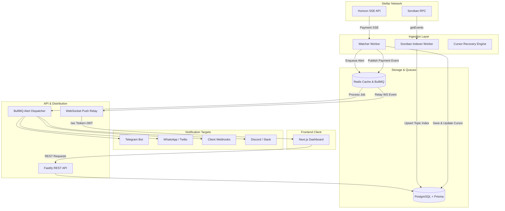

# Current-State Audit: Stellar Alerts

## 1. Product Overview

### 1.1 What the Application Currently Does
Stellar Alerts is a real-time Stellar payment tracking, Soroban event ingestion, and multi-channel notification engine. It monitors public Stellar keys (`G...`) for on-chain payments and Soroban contract events, persists transaction records to PostgreSQL via Prisma, and dispatches asynchronous alerts via BullMQ + Redis to configured communication channels (Telegram, WhatsApp, Webhooks, Slack, Discord, and Email). It features a modern Next.js 16 web dashboard with 3D network visualizers, simulation threat analysis, and an administrative dead-letter queue inspector.

### 1.2 Intended Users & Problems Solved
- **Ordinary Stellar Users & Freelancers**: Need effortless, non-custodial notifications when payments arrive without running nodes or monitoring raw ledger explorers.
- **DAO & Treasury Operators**: Need multi-sig signer threshold tracking and inactivity notifications.
- **DeFi & Smart Contract Developers**: Need webhook/event subscriptions for Soroban contracts, DEX slippage alerts, and pre-execution transaction risk assessments.

### 1.3 Vision vs. Reality Gaps
- **Intended Read-Only Model vs. Implementation**: While public wallet monitoring is strictly non-custodial (`G...`), delete operations in `wallets.controller.ts` (`removeWallet`) lack tenant ownership enforcement (`wallet.userId === userId`).
- **Notification Integrity**: Several external channels (Discord, Slack, Telegram, WhatsApp) are scaffolded or implemented in worker queues, but Telegram mini-app and Webhook sandboxes contain incomplete or divergent routing logic.
- **Developer API**: There is an OpenAPI 3.0 specification (`openapi.json`, `/docs`), but API key management (rate limits by API key, scoped programmatic access) is currently unmanaged; requests rely solely on session JWTs.

---

## 2. Existing Feature Inventory

| Category | Feature | Status | Evidence | Dependencies | Verification | Gaps & Risks |
| :--- | :--- | :--- | :--- | :--- | :--- | :--- |
| **Ingestion** | Horizon SSE Ingestion | ⚠️ Degraded / Syntax Blocked | `watcher.worker.ts` | Horizon, PostgreSQL | Failed (Syntax errors in commit `a62772f`) | Unbalanced braces / broken catch block introduced in PR #115 merge. |
| **Ingestion** | Soroban Topic Indexer | ✅ Implemented | `soroban-indexer.worker.ts` | Soroban RPC, PostgreSQL GIN | Unit tested | High DB IOPS under heavy RPC event load. |
| **Ingestion** | Bounded Cursor Recovery | ✅ Implemented | `cursor-recovery.ts` | Horizon, Prisma | Tested | None; handles outage failovers up to 20 catch-up pages. |
| **Auth** | Passwordless Magic Links | ✅ Implemented | `auth.service.ts` | JWT, Resend/SMTP | Verified via NextAuth | None. |
| **Auth** | Stellar DID (Freighter) | ✅ Implemented | `auth.controller.ts` | `stellar-sdk` | Verified in Web Suite | Challenge expiration is strictly enforced. |
| **Auth** | Refresh Token Rotation | ✅ Implemented | `schema.prisma` (`RefreshSession`) | PostgreSQL | Tested | Automatic revocation upon reuse detected. |
| **Wallet** | Address Registration | ⚠️ Vulnerable | `wallets.service.ts` | StrKey validator | Tested | `removeWallet` does not verify `userId`, allowing cross-user wallet deletion by ID. |
| **Alerts** | BullMQ Redis Queue | ✅ Implemented | `queue.ts` | Redis 7, BullMQ | Tested | Dead letter queue and exponential retry active. |
| **Alerts** | Multi-channel Dispatch | ⚠️ Partial | `queue.ts`, `whatsapp.ts` | Twilio, Telegram Bot API | Tested | Missing dynamic status checks for Discord and Slack webhook URLs. |
| **Dashboard** | Web App UI (Next.js) | ✅ Implemented | `apps/web/src/app` | Next.js 16, TailwindCSS | 100% Pass (38/38 files, 335 tests) | NextAuth secret fallback warning if env is missing. |
| **Security** | Pre-Execution Simulator | ✅ Implemented | `simulation.service.ts` | BigInt Stroop Math | Tested | 0-100 threat score calculated deterministically. |
| **Security** | Webhook HMAC Signatures | ✅ Implemented | `webhook-signer.ts` | Crypto (SHA256) | Tested | Drift tolerance set to 5 minutes. |

---

## 3. Architecture Overview

### 3.1 Data Flow Architecture

---

## 4. Major User Journeys & Verification Status

1. **User Sign-in / Registration**: Verified via email magic link and Freighter wallet DID (`/auth/did/*`). Session JWT issued.
2. **Registering a Monitored Wallet**: User posts public key `G...`. Validated with CRC16-XMODEM checksum. Stored in DB with seeded Horizon cursor.
3. **Transaction Ingestion**: Watcher worker reads Horizon SSE. **Current Failure**: Broken syntax in `watcher.worker.ts` blocks ingestion execution.
4. **Alert Rule Evaluation**: Rules evaluated against payments. Enqueues job to BullMQ if criteria match.
5. **Multi-Channel Alert Delivery**: BullMQ worker dispatches notifications idempotently with exponential retry and DLQ persistence.
6. **Dead Letter & Replay**: Failing webhooks/alerts are sent to `payment-alerts-dlq` and can be replayed in an in-memory sandbox.

---

## 5. Technical Debt and Systemic Risks

- **P0: Ingestion Worker Syntax Corruption**: `apps/api/src/workers/watcher.worker.ts` has mismatched `try/catch` braces introduced in commit `a62772f`. Blocks compiler and worker startup.
- **P0: Broken Operations Runbook Test Syntax**: `apps/api/src/__tests__/operations-runbooks.test.ts` has unclosed braces.
- **P1: Cross-User Wallet Deletion Bug**: `WalletsService.removeWallet(id)` lacks `userId` scoping, allowing arbitrary deletion of other users' monitored wallets if an ID is known.
- **P1: CLI Subcommand Drift**: `packages/cli` tests fail because `profile update` and `profile remove` CLI command definitions drifted from test expectations.
- **P2: Missing Programmatic API Key Management**: REST API only accepts Bearer session JWTs; developer integrations lack distinct scoped API keys and token quotas.
